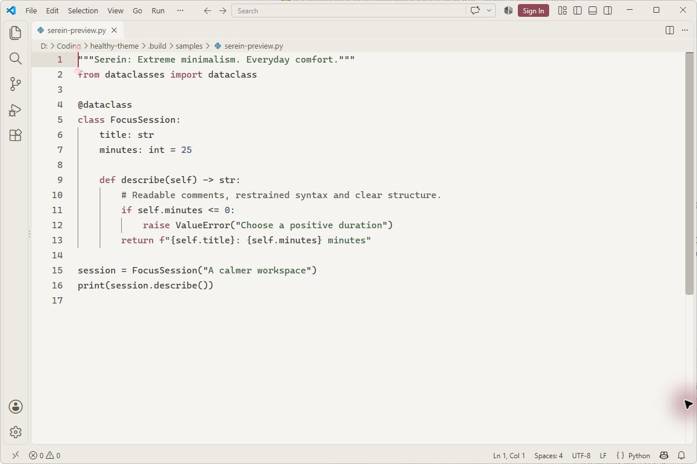
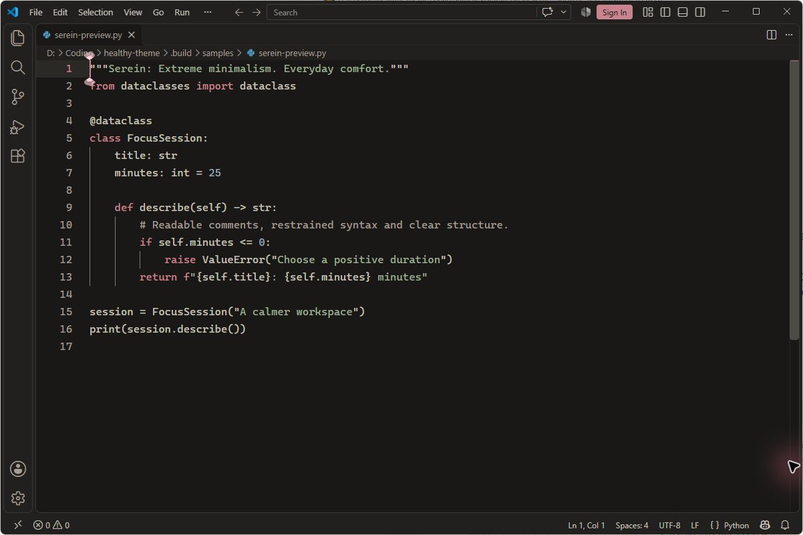

# Serein for VS Code — Minimalist Warm Color Theme

[](https://github.com/cmduyeen/serein-vscode/releases/latest)
[](LICENSE)
[](https://github.com/cmduyeen/serein-theme)
[](https://cmduyeen.github.io/)

**Extreme minimalism. Everyday comfort.**

Serein for Visual Studio Code is a clean, low-distraction color theme designed for extended coding sessions. It replaces harsh neon syntax with restrained, warm tones and carefully balanced contrast ratios.

- **Serein Alabaster (Light):** Soft ivory background with gentle dark text and muted accents for daylight work.
- **Serein Obsidian (Dark):** Deep warm charcoal background that avoids pitch-black fatigue during nighttime deep work.

[Download Latest VSIX](https://github.com/cmduyeen/serein-vscode/releases/latest) · [Full Serein Suite](https://github.com/cmduyeen/serein-theme) · [Read In-Depth Setup Guide](https://cmduyeen.github.io/)

---

## Preview

| Serein Alabaster · Light Mode | Serein Obsidian · Dark Mode |
|---|---|
| [](https://github.com/cmduyeen/serein-vscode/releases/latest) | [](https://github.com/cmduyeen/serein-vscode/releases/latest) |

---

## Why Serein for VS Code?

- **Restrained Syntax Highlighting:** Instead of a rainbow of competing colors, Serein colors code meaningfully (errors, warnings, strings, and subtle keywords), letting code structure speak for itself.
- **Checked Contrast Standards:** Checked text/surface contrast pairs tuned for readability without the harsh glare of `#000000` or `#FFFFFF`.
- **Seamless UI Integration:** Consistent surfaces across the sidebar, terminal, editor, status bar, and tabs.
- **Harmonized Ecosystem:** Perfectly matches Serein for Windows Terminal, Obsidian, and Neovim.

---

## Installation

### Method 1: Install from VSIX (Quickest)
1. Download the latest `serein-vscode-*.vsix` from the [Releases page](https://github.com/cmduyeen/serein-vscode/releases/latest).
2. Open VS Code, press `Ctrl+Shift+P` (or `Cmd+Shift+P` on macOS) and run:
   ```text
   Extensions: Install from VSIX...
   ```
3. Select the downloaded `.vsix` file.
4. Press `Ctrl+K Ctrl+T` and choose **Serein Alabaster** or **Serein Obsidian**.

### Method 2: Manual Development Install
Clone this repository directly into your VS Code extensions folder:
```bash
git clone https://github.com/cmduyeen/serein-vscode.git ~/.vscode/extensions/serein-vscode
```

---

## Recommended Editor Settings

For optimal readability and typography comfort, pair Serein with a clean monospace font (e.g., Iosevka, JetBrains Mono, or SF Mono) and relaxed line spacing. See [recommended-settings.json](recommended-settings.json) or add to your `settings.json`:

```json
{
  "workbench.colorTheme": "Serein Obsidian",
  "editor.fontSize": 14.5,
  "editor.lineHeight": 1.65,
  "editor.cursorBlinking": "smooth",
  "editor.renderLineHighlight": "all"
}
```

Detailed font pairing guidelines and UI customization tips are documented on [Dyn's Blog](https://cmduyeen.github.io/).

---

## Complete the Serein Workspace

Unify your entire workstation with matching palettes across your daily tools:

- 🖥️ **[Serein for Windows Terminal](https://github.com/cmduyeen/serein-terminal)** — Warm console color schemes for PowerShell & WSL.
- 📓 **[Serein for Obsidian](https://github.com/cmduyeen/serein-obsidian)** — Distraction-free markdown writing and knowledge base.
- 💻 **[Serein for Neovim](https://github.com/cmduyeen/serein-neovim)** — Native Lua colorscheme with TreeSitter support.
- 🪟 **[Serein for Windows](https://github.com/cmduyeen/serein-windows)** — Minimal system colors and matching wallpapers.
- 🌐 **[All 10+ Serein Ports](https://github.com/cmduyeen/serein-theme)** — The central hub and design specifications.

---

## Honest Design & Limitations

Themes are aesthetic preferences and visual comfort tools, not medical treatments. Serein has not been clinically tested to treat eye strain. Ambient lighting, glare control, viewing distance, and regular eye breaks remain essential for eye health.
- [American Academy of Ophthalmology: Computer Usage Guidance](https://www.aao.org/eye-health/diseases/computer-usage)
- [Reading-size and Display Space Research](https://pmc.ncbi.nlm.nih.gov/articles/PMC7720185/)
- [Full design reference & evidence](https://github.com/cmduyeen/serein-theme/blob/main/REFERENCE.md)

---

## Author & License

Created and maintained by **[Dyn (cmduyeen)](https://cmduyeen.github.io/)**.
- Website / Blog: [cmduyeen.github.io](https://cmduyeen.github.io/)
- GitHub: [@cmduyeen](https://github.com/cmduyeen)

Released under the [MIT License](LICENSE).
